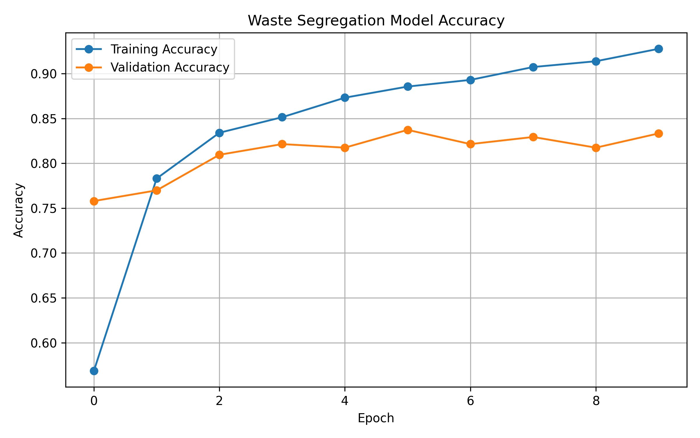
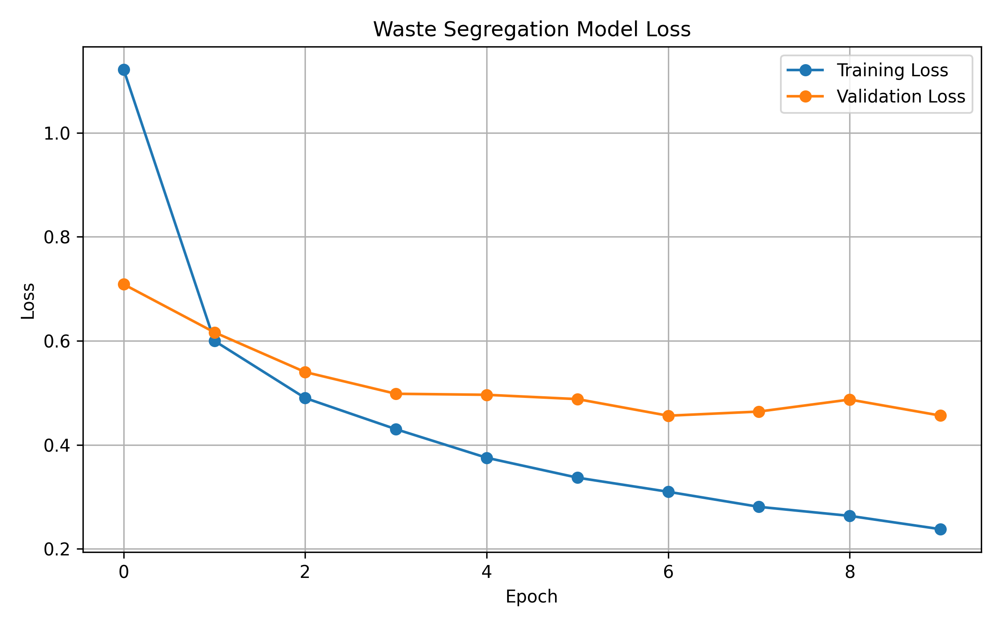
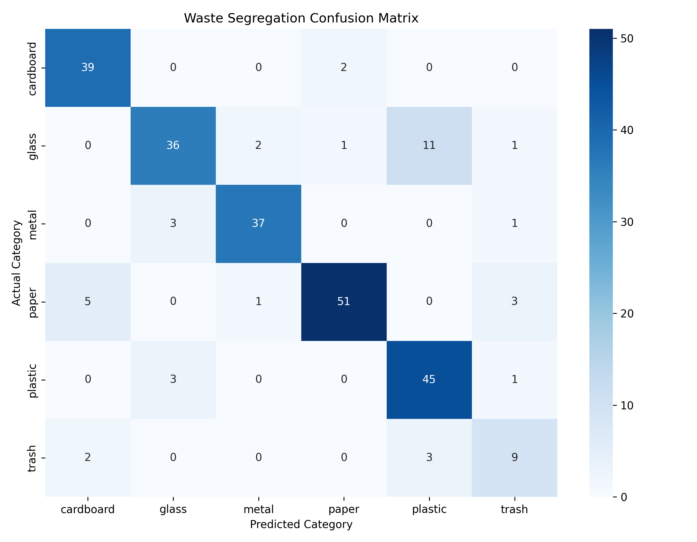

# Waste Segregation AI ♻️

## Project Overview

Waste Segregation AI is a deep learning project that classifies waste images into six categories using Python, TensorFlow, and MobileNetV2. It uses transfer learning to identify different types of waste and supports better waste sorting and recycling.

## Objectives

- Classify waste images automatically.
- Identify six different waste categories.
- Apply transfer learning using MobileNetV2.
- Evaluate model performance using accuracy, loss, and a confusion matrix.

## Waste Categories

The model classifies waste into the following categories:

- Cardboard
- Glass
- Metal
- Paper
- Plastic
- Trash

## Technologies Used

- Python
- TensorFlow and Keras
- MobileNetV2
- NumPy
- Matplotlib
- Scikit-learn
- Google Colab

## Model Details

- **Model:** MobileNetV2
- **Approach:** Transfer Learning
- **Input Image Size:** 224 × 224 pixels
- **Number of Classes:** 6
- **Training Epochs:** 10

## Model Performance

The trained model achieved **84.77% test accuracy** on 256 test images.

| Metric | Result |
|---|---:|
| Training Accuracy | 92.77% |
| Validation Accuracy | 83.33% |
| Test Accuracy | 84.77% |
| Test Loss | 0.4395 |

## Performance Visualizations

### Accuracy Graph

### Loss Graph

### Confusion Matrix

## Project Files

| File | Description |
|---|---|
| `Waste_Segregation_AI.ipynb` | Notebook containing the project code |
| `waste_accuracy_graph.png` | Training and validation accuracy graph |
| `waste_loss_graph.png` | Training and validation loss graph |
| `waste_confusion_matrix.png` | Classification evaluation matrix |

## How to Run

1. Open `Waste_Segregation_AI.ipynb` from this repository.
2. Open the notebook in Google Colab.
3. Run the cells in order.
4. Download the dataset using the dataset-loading code in the notebook.
5. Train and evaluate the model.

A GPU-enabled runtime is recommended for faster training.

## Future Improvements

- Improve classification performance for underrepresented waste categories.
- Add a simple web interface for image upload and prediction.
- Deploy the trained model for real-time waste classification.

## Conclusion

This project demonstrates how deep learning and transfer learning can be applied to waste image classification. It provides experience in image preprocessing, model training, evaluation, and visualization using TensorFlow and Python.
